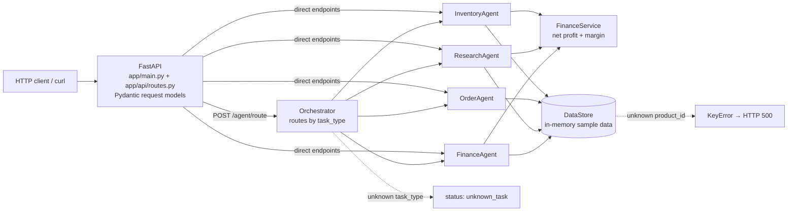

# Whatnot Automation MVP

This repository is a lightweight operations automation starter for a Whatnot business. It includes a multi-agent backend that covers:

- Inventory monitoring
- Order status guidance
- Research and sourcing opportunities
- Finance and pricing analysis
- Orchestration across all AI tasks

## Stack

- Python
- FastAPI
- Pydantic
- OpenAI API

## Basic project structure

- app/main.py
- app/api/routes.py
- app/agents/
- app/services/
- app/data/store.py

## Quick start

1. Create a virtual environment:

   python -m venv .venv
   source .venv/bin/activate

2. Install dependencies:

   pip install -r requirements.txt

3. Set your environment variables:

   cp .env.example .env

4. Run the app:

   uvicorn app.main:app --reload

## Example requests

Inventory check:

curl -X POST http://localhost:8000/inventory/check \
  -H "Content-Type: application/json" \
  -d '{"product_id":"sku-1001","quantity_needed":12}'

Order status:

curl -X POST http://localhost:8000/orders/status \
  -H "Content-Type: application/json" \
  -d '{"order_id":"ord-001"}'

Research opportunities:

curl -X POST http://localhost:8000/research/source \
  -H "Content-Type: application/json" \
  -d '{"category":"phone accessories","max_cost":5.0,"target_margin":0.4,"max_results":3}'

Profit estimate:

curl -X POST http://localhost:8000/finance/profit \
  -H "Content-Type: application/json" \
  -d '{"product_id":"sku-1001","quantity":4}'

## Architecture



| Module | Responsibility |
|---|---|
| `app/api/routes.py` | Request validation (Pydantic) and endpoint wiring |
| `app/agents/orchestrator.py` | Single entry point that dispatches `inventory`, `order`, `research`, `finance` tasks |
| `app/agents/*_agent.py` | One agent per business domain, each returning a structured JSON decision + recommendation |
| `app/services/finance_service.py` | Shared unit economics: revenue − product − shipping − packaging − platform fee |
| `app/services/openai_service.py` | OpenAI wrapper (gpt-4o-mini) with a no-key fallback; **not yet called by the agents** |
| `app/data/store.py` | In-memory products, inventory, and orders (sample data only) |

**Failure points today:** an unknown `product_id` raises `KeyError` and returns a 500 instead of a 404; all state is lost on restart; there is no auth on any endpoint.

## System design notes

- **Agent per domain, one orchestrator.** Each domain (inventory, orders, sourcing, finance) is isolated in its own class, so it can later be swapped for an LLM-backed or separate service without touching the API layer. The orchestrator gives a single `/agent/route` entry point for chat or workflow tools.
- **Deterministic first, LLM second.** Current agents are rule-based: margins, reorder checks and next actions are computed, not generated. That keeps money math auditable and testable. The OpenAI service is in place for summarization and explanations, but it is intentionally not on the decision path yet.
- **Shared finance logic.** Inventory, research and finance agents all call `FinanceService`, so every margin number comes from one formula.
- **Human in the loop.** Agents only *recommend* (reorder, reprice, validate payment). Nothing places orders, moves money, or contacts customers.
- **Tradeoffs:** in-memory storage keeps the MVP dependency-free but is not concurrent-safe or persistent; synchronous agent calls are fine at this scale but would need a queue for long-running research.

## Deploy & ops

**Local**

```bash
python -m venv .venv && source .venv/bin/activate
pip install -r requirements.txt
cp .env.example .env
uvicorn app.main:app --reload        # http://localhost:8000/docs for the OpenAPI UI
curl http://localhost:8000/health
```

**Docker**

```bash
docker build -t whatnot-automation-agent .
docker run --rm -p 8000:8000 --env-file .env whatnot-automation-agent
```

**Environment variables** (`app/core/config.py`)

| Variable | Used today? | Notes |
|---|---|---|
| `OPENAI_API_KEY` | Optional | Only needed by `OpenAIService`; the app runs fully without it |
| `DATABASE_URL` | Read, not used | Placeholder for the planned Postgres/SQLite store |
| `REDIS_URL` | Read, not used | Placeholder for future queueing/caching |
| `APP_ENV` | Read | `development` by default |

**Secrets:** `.env` is git-ignored; never commit real keys. The repo history was scanned before it was made public and contains only sample data (`alice@example.com` etc.).

**CI:** none yet. Planned: pytest + linting on every PR.

**Known limits:** sample data only, no persistence, no auth, no rate limiting, no real Whatnot/supplier/shipping integrations, and unknown IDs return 500.

## Results

Real outputs from the bundled sample data (not production numbers):

| Request | Result |
|---|---|
| `POST /finance/profit` `sku-1001`, qty 4 | revenue $59.96, fees $4.80, net profit $29.16, margin 48.6% → "Strong margin" |
| `POST /research/source` phone accessories, max cost $5, target 40% | 1 match: Minimal Phone Case, 48.6% margin, $7.29 net per unit |
| `POST /inventory/check` `sku-1002`, need 12 | `low_stock` (8 on hand) → recommend reorder |

## Current maturity

This is intentionally an MVP. It is built as an operational foundation, not a full production ERP. The goal is to give you a real starting point for:

- product sourcing decisions
- stock alerts
- margin tracking
- order flow triage
- business orchestration

## Recommended next steps

- Swap the in-memory sample store for PostgreSQL
- Add real supplier and shipping APIs
- Add human approval thresholds for risky finance choices
- Add authentication and admin routes
- Expand each agent into separate services and workflows
